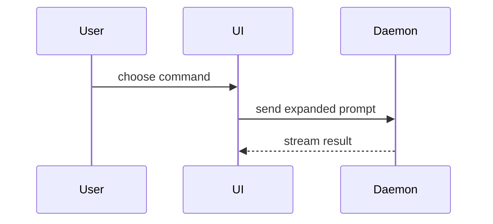
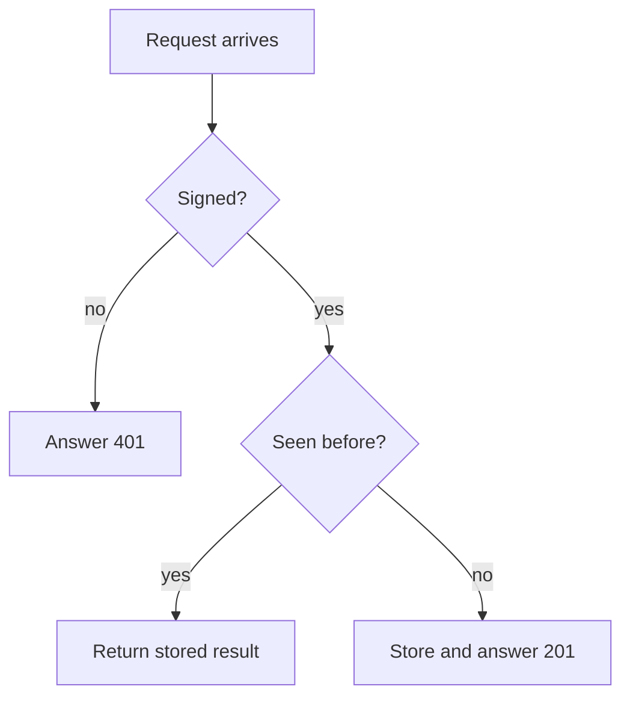
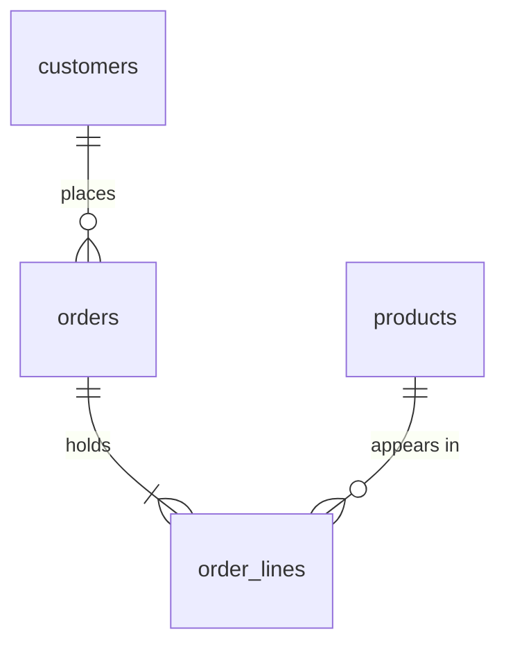
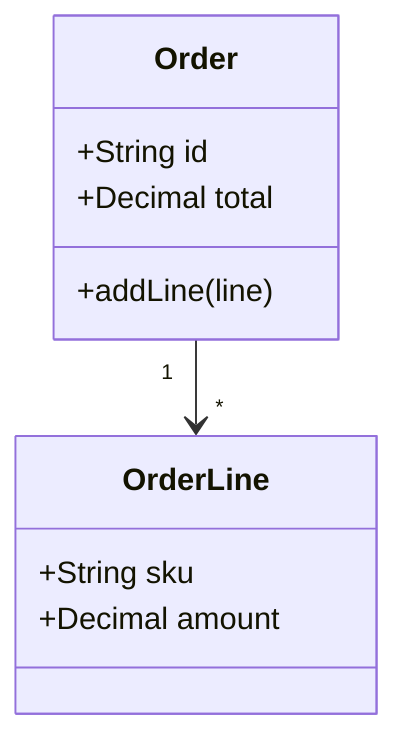
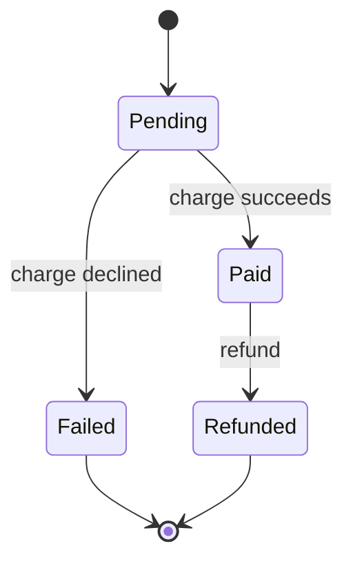

# Plan: Mermaid diagrams as pictures in the Claude Code terminal

## Goal

Build a Claude Code mod that draws the Mermaid blocks of an assistant reply as pictures in Ghostty. Today the transcript shows a Mermaid block as lines of source code. The `/show-me` skill is the main case. It writes a Mermaid block to explain a flow, and the reader sees only the source.

The mod does three things:

1. It draws each `mermaid` fenced block of an assistant reply as an image, in place, inside the transcript, where the source lines would have been.
2. It leaves the stored message unchanged, so ctrl+o still shows the source.
3. It draws the original source block wherever it cannot draw a picture.

Out of scope:

- A side pane for diagrams. The picture belongs in the reply, next to the text that explains it.
- Diagrams inside tool output, tool results and subagent replies.

## How to start the session

1. Run `git init` in this folder.
2. Load the `plugin-authoring` skill before anything else. It writes the API types for the installed Claude Code build and explains the mod layout and the hot reload.
3. Develop with `claude --plugin-dir <this folder>`, so each edit reloads when the turn ends.
4. Before relying on any API name below, grep the types file the skill writes for it. The facts below come from Claude Code 2.1.331 and may have moved.

## API facts this plan relies on

Rendering the reply:

- A `ui.render` hook on `{ component: 'AssistantMessage' }` gets `e.props.text`, the block's markdown as the transcript would draw it. The hook may return its own tree. The rewrite changes only the drawing and leaves the stored message alone.
- The terminal surface has an `Image` element. Its props are `source`, `columns` and `rows` from 1 to 255, `alt`, and an optional `key`. `source` takes `{ png }` as base64, `{ rgba, width, height }`, or `{ file, format }`.
- `Image` draws through the Kitty graphics protocol in kitty and Ghostty, and in iTerm2 3.5 or later. Everywhere else it draws `alt`. Inside tmux it needs `allow-passthrough` and `focus-events` turned on.
- An `Image` is made of text cells, so it scrolls and clips like a word.
- The terminal surface also has `Markdown` and `Code` elements for the prose around a diagram.
- The surface reports its monospace cell metric. The mod needs it to pick `rows` that keep the picture's aspect ratio.

State and processes:

- A render hook must not write state. `$.state.set` while drawing is denied. Rendering has to start from another event or a handler, and the render hook only reads the result.
- `$.state` survives a hot reload. A module variable does not.
- `$.process.run(argv, { cwd, env, stdin, timeoutMs })` runs a host command without a shell. The default timeout is 30 seconds.
- `$.fs` reads, writes, lists and stats files. `$.fs.read(path, { as: 'bytes' })` returns base64.

## Renderer

`mmdc` from mermaid-cli works, but it starts a headless Chromium for every diagram. The mmdr project measures about 2.5 seconds of cold start for it. These renderers need no browser:

| Renderer | Language | Output | Install |
| --- | --- | --- | --- |
| [mermaid-rs-renderer](https://github.com/1jehuang/mermaid-rs-renderer), binary `mmdr` | Rust | SVG, and PNG through resvg | `cargo install mermaid-rs-renderer` |
| [merman-cli](https://docs.rs/merman-cli) | Rust | SVG, PNG, ASCII, with `mmdc`-style flags | `cargo install merman-cli` |
| [mermaid-rs-cli](https://docs.rs/crate/mermaid-rs-cli/latest/source/README.md), binary `mmrs` | Rust | SVG, PNG, ASCII | `cargo install mermaid-rs-cli` |
| [beautiful-mermaid](https://github.com/lukilabs/beautiful-mermaid) | TypeScript, no DOM | SVG, Unicode text | npm |

These projects reimplement the Mermaid layout, so their output can differ from mermaid-js, and some diagram types may be missing. The speed figures are each project's own claims. Step 1 settles the choice by test.

Rendering stays on the machine. Never send diagram source to a rendering service such as kroki.io, because the diagrams describe private code.

## Steps

### 1. Pick the renderer

Render every sample at the end of this file with `mmdc`, `mmdr` and `merman-cli`. For each renderer, record:

- the time per diagram,
- which samples fail or come out wrong,
- how the PNG reads on a dark background in Ghostty.

Keep the renderer with the fewest failures and readable output. Make the renderer command a `userConfig` option of the mod, with the winner as the default, so `mmdc` stays available as a fallback.

### 2. Spike the risky part first

Write the smallest mod that answers the first two open questions below. It draws a fixed PNG with `Image` from a `ui.render` hook on `AssistantMessage`, for any reply whose text holds a `mermaid` fence. Check that:

- the engine accepts `Image` inside an `AssistantMessage` tree,
- the picture scrolls with the transcript and disappears when it scrolls away,
- it works in the fullscreen layout and on the main screen.

If the engine refuses `Image` there, stop and ask Andrea before building anything else. The only other route is a side pane, and the inline picture is the point of this mod.

### 3. Build the render pipeline

1. Find the fences. Parse the fenced blocks whose info string is `mermaid`. Key each block by a hash of its source, the theme and the width it is drawn at.
2. Start the render outside the render hook. Use the event the spike showed to work, `turn.step` or `turn.complete`. Also scan the transcript at `session.start`, so a resumed session gets its pictures.
3. Write the source to a file in the mod's data folder, and run the renderer with `$.process.run` and a timeout of 10 seconds.
4. Keep the PNG on disk and store only its path in `$.state`, keyed by the hash. Draw it with `source: { file, format: 'png' }`. Cap the cache, for example at 100 files, and delete the oldest.
5. Render one hash once, even when the same block appears twice.

### 4. Draw the reply

The `AssistantMessage` hook splits `e.props.text` into prose and diagram segments:

- A prose segment draws with `Markdown`.
- A diagram with a PNG ready draws with `Image`, with the Mermaid source as `alt`.
- A diagram still rendering, or one that failed, draws as the original fenced block with `Code`.
- A reply with no `mermaid` fence returns `next(e)` unchanged.

Size each picture from the PNG's pixel size and the cell metric. Use the transcript width as the upper bound for `columns`, work out `rows` from the aspect ratio, and clamp both to 255 and to about 60% of the visible rows.

Pick the Mermaid theme from the terminal background, dark or light, and render with a transparent background.

### 5. Handle failures

- The renderer is missing, fails, or times out: draw the source block and write the error with `$.ui.log` at debug level.
- The terminal cannot draw images: `Image` falls back to `alt` by itself. Check that the result still reads like the old code block.

### 6. Test

- `claude plugin validate <folder>` and `tsc -p <folder>` pass.
- `claude plugin test <folder>` covers these cases:
  - a reply with no Mermaid fence draws exactly as before,
  - a reply with one ready diagram draws prose, picture, prose,
  - a diagram still rendering draws as source,
  - a failed render draws as source,
  - two identical blocks render once.
- By hand in Ghostty, run `/show-me` on a topic that produces a sequence diagram, in both layouts. Then repeat inside tmux without passthrough and expect the source.

## Acceptance criteria

- A `/show-me` reply with a Mermaid block shows the picture in the transcript in Ghostty, in place of the source.
- ctrl+o shows the original Mermaid source.
- No diagram source leaves the machine.
- A terminal without Kitty graphics shows the source as before.

## Open questions

1. Does the engine accept `Image` inside an `AssistantMessage` tree?
2. Can a render hook start async work that writes state later, or must rendering start from a turn event?
3. Does prose drawn with the mod's own `Markdown` element look the same as the engine's own drawing of the reply?
4. Does `Image` need the fullscreen layout in Ghostty? The type docs mention fullscreen rendering in the same sentence as iTerm2, which leaves it unclear.
5. Where does the mod read the terminal background color, to pick the Mermaid theme?

## Samples for step 1

