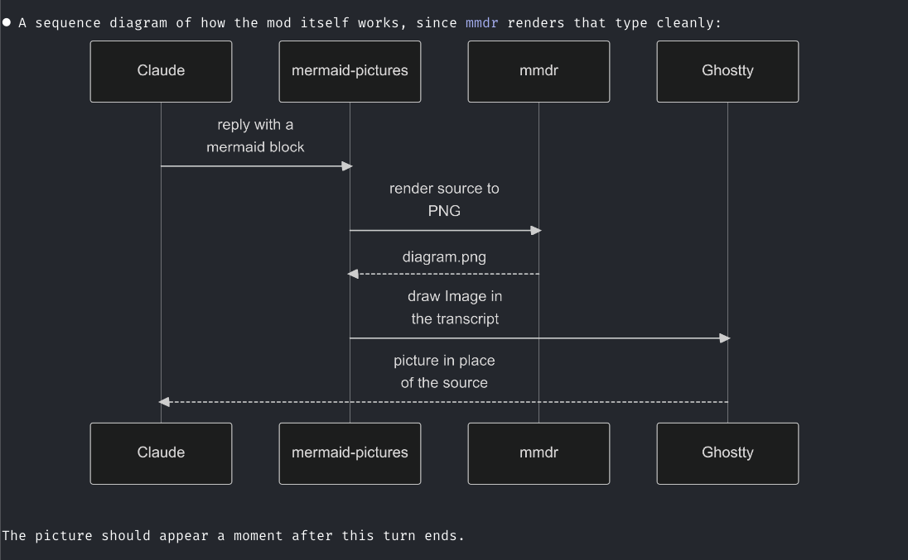

# mermaid-pictures

A Claude Code mod that draws the `mermaid` blocks of an assistant reply as pictures in the transcript, in place of their source. Rendering runs on your machine, and diagram source is never sent to a rendering service.



## Requirements

- Ghostty or kitty. In other terminals, and inside tmux, the mod leaves the source as it was.
- [mmdr](https://github.com/1jehuang/mermaid-rs-renderer), a Mermaid renderer written in Rust:

  ```sh
  cargo install mermaid-rs-renderer
  ```

## Install

At the prompt of a Claude Code session:

```
/plugin install mermaid-pictures --marketplace andreagrandi/claude-mermaid-mod
```

## Usage

Diagrams turn into pictures when Claude's turn ends. A diagram still rendering, or one that failed, shows as source.

A picture is capped at 90% of the screen's height. When that makes it smaller than its full size, an `enlarge` button sits under it. Click it to draw the picture as wide as the transcript, up to 255 rows, and click `shrink` to bring it back.

To copy a diagram's source, run `/mermaid-source`. Mermaid blocks then show their source until you run it again. ctrl+o still shows the picture, because Claude Code doesn't tell the mod when a reply is drawn in the ctrl+o view.

## Options

Set these in `/config`:

- `renderer`: `mmdr`, the default, or `mmdc` from [mermaid-cli](https://github.com/mermaid-js/mermaid-cli), which matches mermaid.js exactly but starts a browser for each diagram.
- `rendererPath`: the renderer's absolute path. Empty looks on your `PATH`, then in `~/.cargo/bin`.

## Known limits

`mmdr` reimplements Mermaid's layout. Sequence diagrams and flowcharts come out right. In version 0.3.1, ER diagrams keep the quotes around relationship labels, class diagrams drop multiplicity labels, and state diagram labels can overlap.

## Develop

```sh
claude plugin validate .
claude plugin test .
claude --plugin-dir .
```

## License

MIT. See [LICENSE](LICENSE).
